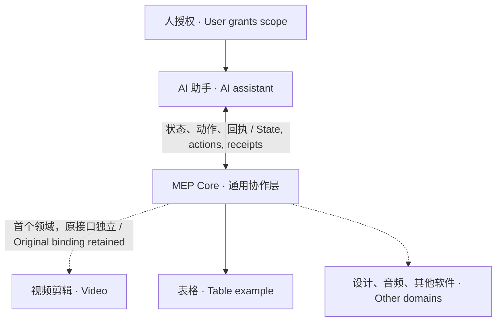
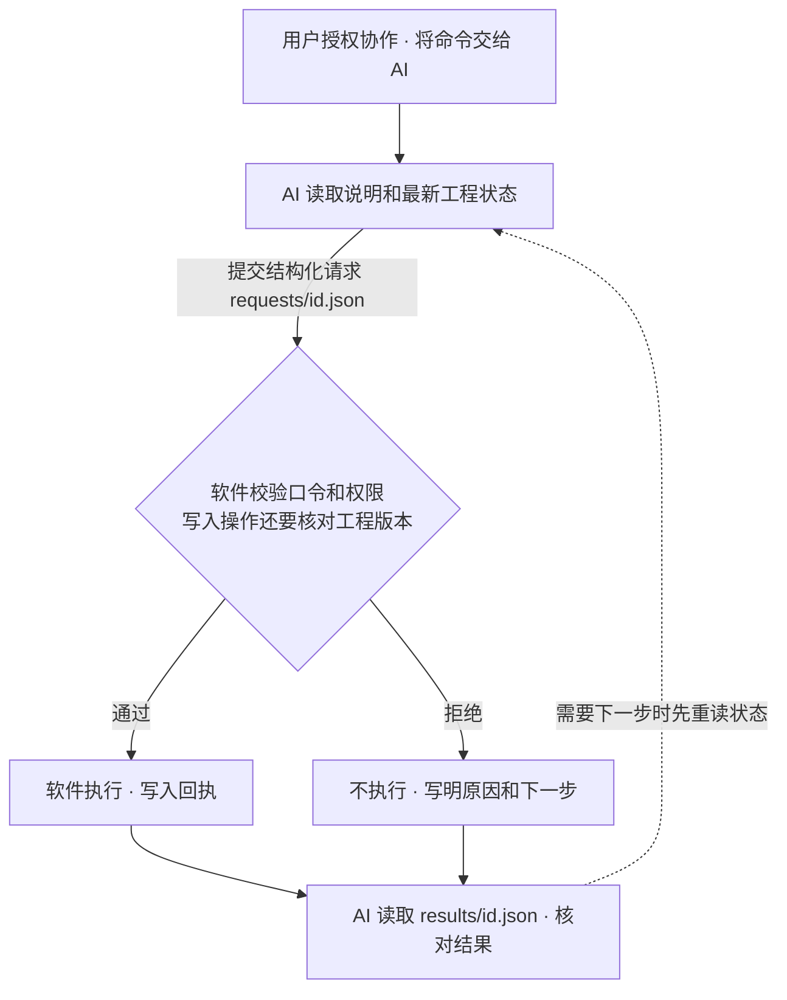
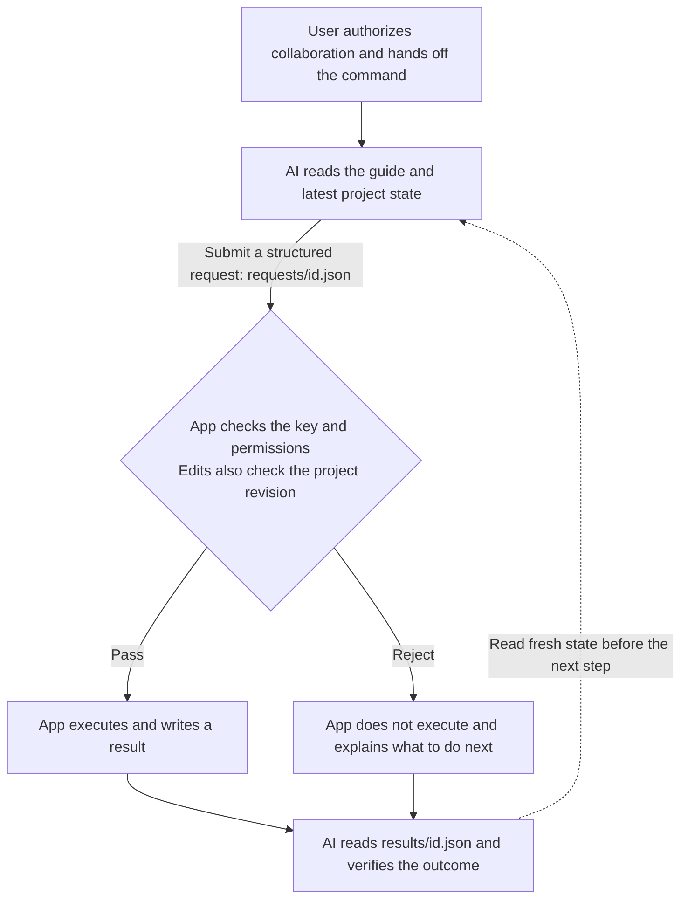

<p align="center">
  
</p>

<h1 align="center">MEP · Motion Edit Protocol</h1>

<p align="center">
  由 <b>阿杜实验室</b> 发起的开放 AI 软件协作协议<br>
  An open AI–software collaboration protocol initiated by <b>ADu Labs</b>
</p>

<p align="center">
  <b>首批参与项目 / Early participants</b><br>
  <a href="https://adudir.com">阿杜导演 · ADuDir</a>（视频剪辑 / Video editing）
</p>

---

## 协议架构 / Protocol architecture

| 层 / Layer | 规范与代码 / Specification and code | 状态 / Status |
|---|---|---|
| **通用核心 / Core** | [MEP Core 1](CORE.md) · [JSON Schema](schema/core.schema.json) | 公开草案 / Public draft |
| **领域规范 / Domains** | [视频剪辑 / Video](SPEC.md) · [English spec](SPEC.en.md) | `mep/1` 1.0 正式版，保持兼容 / stable and unchanged |
| **跨领域接入示例 / Cross-domain example** | [可运行的表格示例 / Runnable table example](examples/core-table/README.md) | 示例，非第三方集成 / Example, not a third-party integration |



Core 统一协作规则，各领域独立定义动作。原视频接口不变。  
Core standardizes collaboration; each domain defines its actions. The original video interface is unchanged.

## 中文

**MEP（Motion 剪辑协议）是让 AI 助手与软件直接协作的开放协议，从视频剪辑开始。**
剪辑软件把工程开放成一个文件夹，助手读文件了解工程、写文件提交修改，软件校验后执行并写回执。

> MCP 给助手接一根线，MEP 给助手一张工作台。

- 不装插件、不改配置、不重启助手：任何能读写本机文件的助手都能用。
- 接入不占上下文；不靠截图；执行由软件按确定规则完成，不调用模型。
- 每单带版本号，不覆盖用户的新修改；每单有回执，可整单撤销。
- 助手可以请软件把成片某几秒画出来，自己检查后再交差。

### 不只是剪辑：给 AI 时代的软件一张工作台

**视频剪辑是 MEP 的第一个应用场景，不是这个协作模式的边界。** 只要一款软件能把当前工作状态表示成结构化数据，并把常用操作定义成可校验的命令，理论上都能沿用 MEP 的模式，让 AI 不再靠猜界面、点按钮来干活。人给目标，AI 拆成步骤，软件按自己的规则执行，结果再交回给 AI 和用户核对。

| 软件 | 可以怎样协作 |
|---|---|
| 设计工具 | 读画板和组件，批量换文案、改主题色，再核对预览。 |
| 音频工作站 | 读音轨和时间标记，调整片段或轨道增益，再回听检查。 |
| 表格与数据工具 | 读取列结构和校验规则，提交批量清洗或更新，查看受影响的行与失败原因。 |

效率提升来自**减少重复操作，以及减少 AI 为理解界面而反复截图、试点和确认的往返**。一条指令可以对应一批操作，应用仍然掌管权限、数据和执行规则。[MEP Core 1](CORE.md) 定义了跨软件通用的协作规则；视频是已发布的领域绑定，表格有可运行的参考示例，其他领域仍需各自定义状态、命令和结果。

### 一分钟看懂视频剪辑的协作流程



一个请求：

```json
{
  "mep": 1,
  "key": "本单口令",
  "who": "Codex",
  "base": "project.json 的 revision",
  "ops": [{ "op": "cut", "clip": "片段id", "at": 12.4 }]
}
```

一份回执：

```json
{ "mep": 1, "id": "r-01", "ok": true, "at": 1763520001234, "revision": "新版本号",
  "changes": { "created": [], "removed": [] } }
```

### 仓库内容

| 路径 | 内容 |
|---|---|
| [SPEC.md](SPEC.md) | MEP 1 规范（目录、单据与口令、心跳、请求、回执、错误码、七种请求、编辑项的公共约定、代码场景、安全、版本、一致性要求） |
| [schema/](schema/) | JSON Schema：请求、回执、`status.json`、`mep.json` |
| [examples/](examples/) | 示例 `mep.json`、心跳、请求与回执 |
| [reference/submit.mjs](reference/submit.mjs) | 参考提交脚本（Node.js，无依赖） |
| [docs/why-mep.md](docs/why-mep.md) | MEP 与 MCP、Computer Use 的对比和设计理由 |

### 视频剪辑参考实现

- **宿主（剪辑软件）**：按 [SPEC.md §15](SPEC.md#15-一致性要求) 的最低要求实现协作目录、单据、心跳、请求校验与回执。
- **助手**：读协作目录里的 `README.md`，按 `mep.json` 写请求即可，不需要任何 SDK。

参考实现：[阿杜导演](https://adudir.com)（桌面版 1.3.5 起）。下载与了解更多见官网 [adudir.com](https://adudir.com)。

### 许可

[Apache License 2.0](LICENSE)。任何软件、任何助手都可以实现 MEP，无需另行授权。

---

## English

**MEP (Motion Edit Protocol) is an open protocol for direct collaboration between AI assistants and software, starting with video editing.**
The editor opens a project as a folder. The assistant reads files to understand the project and writes files to submit changes. The editor validates and executes each change, then writes back a result.

> MCP gives the assistant a cable. MEP gives it a workbench.

- No plugin, no configuration, no assistant restart. Any assistant that can read and write local files can use it.
- Nothing occupies the context window while idle. No screenshots. Execution follows deterministic rules in the editor and calls no model.
- Every request carries the project version it was written against, so it never overwrites the user's newer edits. Every request gets a result and can be undone in one step.
- The assistant can ask the editor to render any moment of the final video and check its own work before handing it over.

### Beyond video: a workbench for AI-era software

**Video editing is MEP's first use case, not the limit of the collaboration model.** Any application that can expose its working state as structured data and define actions it can validate can, in principle, adopt this pattern. The user sets the goal, the assistant turns it into concrete steps, and the app executes them under its own rules and returns a result both can verify.

| Application | Example workflow |
|---|---|
| Design tools | Read artboards and components, replace copy or theme colors in bulk, then check the preview. |
| Digital audio workstations | Read tracks and time markers, adjust clips or track gain, then play back the result. |
| Spreadsheets and data tools | Read column definitions and validation rules, submit a batch cleanup or update, then inspect affected rows and any failures. |

The efficiency gain comes from **batching repeatable work and reducing the back-and-forth of interpreting screens, clicking controls, and checking what happened**. The app still owns permissions, data, and execution rules. [MEP Core 1](CORE.md) defines the shared rules. Video remains the published domain binding; the table example is runnable, and other domains still need to define their own state, commands, and results.

### One-minute overview of the video workflow



A request:

```json
{
  "mep": 1,
  "key": "order key",
  "who": "Codex",
  "base": "revision from project.json",
  "ops": [{ "op": "cut", "clip": "clip-id", "at": 12.4 }]
}
```

A result:

```json
{ "mep": 1, "id": "r-01", "ok": true, "at": 1763520001234, "revision": "new revision",
  "changes": { "created": [], "removed": [] } }
```

### What's in this repository

| Path | Contents |
|---|---|
| [SPEC.en.md](SPEC.en.md) | The MEP 1 specification: folder layout, orders and keys, heartbeat, requests, results, error codes, the seven request kinds, common conventions for edit items, code scenes, security, versioning, conformance |
| [schema/](schema/) | JSON Schemas for requests, results, `status.json` and `mep.json` |
| [examples/](examples/) | Sample `mep.json`, heartbeat, requests and results |
| [reference/submit.mjs](reference/submit.mjs) | Reference submit script (Node.js, no dependencies) |
| [docs/why-mep.en.md](docs/why-mep.en.md) | MEP compared with MCP and Computer Use, and the design rationale |

### Video editing reference implementation

- **Host (the editor):** implement the collaboration folder, orders, heartbeat, request validation and results, as listed in the minimum requirements of [SPEC.en.md §15](SPEC.en.md#15-conformance).
- **Assistant:** read the `README.md` in the collaboration folder and write requests as `mep.json` describes. No SDK needed.

Reference implementation: [ADuDir](https://adudir.com) desktop, version 1.3.5 and later. Download it and learn more at [adudir.com](https://adudir.com).

### License

[Apache License 2.0](LICENSE). Any application and any assistant may implement MEP without further permission.
